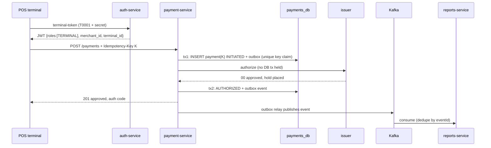
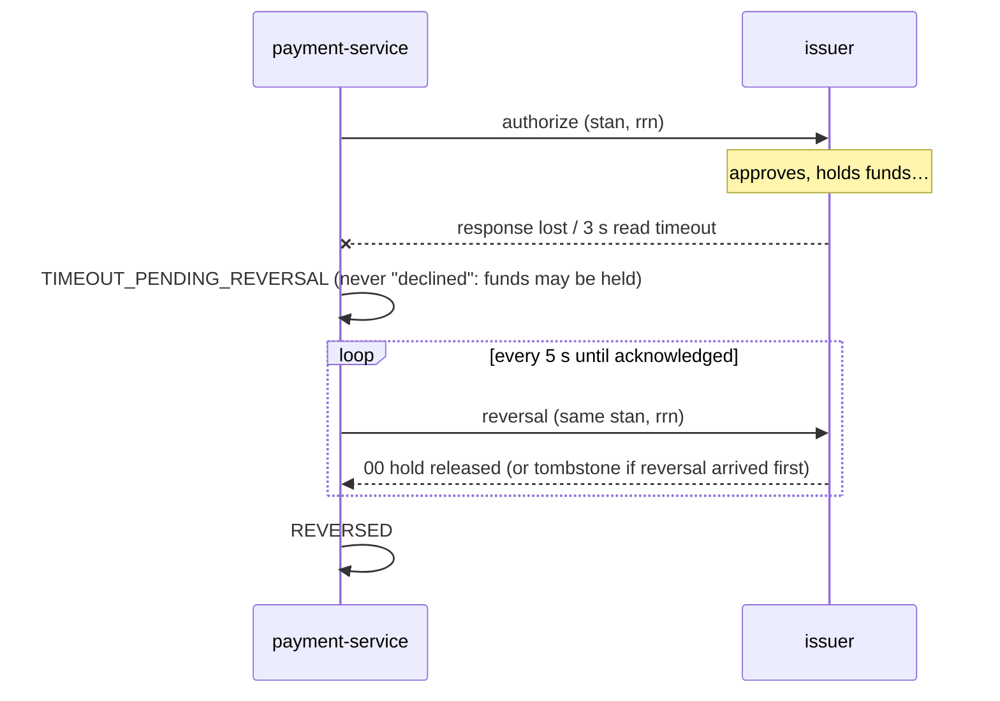
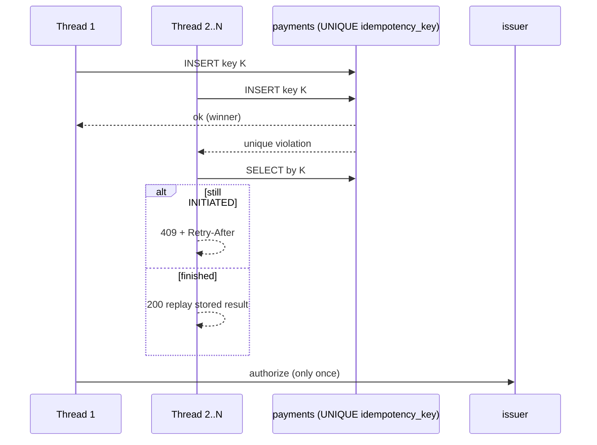

# POS Payments — card-present payments on Java 21 microservices

A working reference implementation of what happens when a customer taps, inserts or swipes a
card at a POS terminal: authentication, authorization, holds, timeouts, reversals, duplicate
protection (idempotency), capture, settlement, and transaction reporting.

| Service | Port | What it does |
|---|---|---|
| `auth-service` | 8081 | Issues RS256 JWTs for users and POS terminals, JWKS endpoint, refresh-token rotation, lockout, user admin |
| `payment-service` | 8082 | The acquirer side: idempotent authorization, state machine, reversals, capture/void, batch close, transactional outbox |
| `issuer-simulator` | 8083 | Stands in for card network + issuing bank: holds, reversals, captures, test cards (in-memory) |
| `reports-service` | 8084 | Idempotent Kafka consumer, transaction projection, audit trail, summaries, CSV export |

Infrastructure: PostgreSQL 16 (database per service), Apache Kafka 3.9 (KRaft).
Stack: Java 21 (records, sealed interfaces, pattern-matching `switch`, virtual threads),
Spring Boot 3.5, Spring Security OAuth2 resource server, Spring Data JPA, Flyway, Spring Kafka,
Resilience4j.

```
                 ┌──────────────┐  JWT (RS256)   ┌──────────────┐
  POS terminal ─►│ auth-service │◄──── JWKS ─────┤ every service│
                 └──────────────┘                └──────────────┘
        │ Bearer token + Idempotency-Key
        ▼
 ┌─────────────────┐  REST (ISO 8583 in prod) ┌──────────────────┐
 │ payment-service │─────────────────────────►│ issuer-simulator │
 └───────┬─────────┘                          └──────────────────┘
         │ outbox ──► Kafka "payments.transaction-events" ──► ┌─────────────────┐
         ▼                                                    │ reports-service │
     payments_db                                              └────────┬────────┘
                                                                  reports_db
```

---

## 1. Run it locally

### Option A — everything in Docker (simplest)

Prerequisites: Docker Desktop (or Docker Engine + Compose v2), plus `curl` and `jq` for the demo.

```bash
docker compose up --build        # first build takes a few minutes (Maven downloads)
./scripts/demo.sh                # walks through every scenario below
```

### Option B — infra in Docker, services from your IDE

Prerequisites: JDK 21, Maven 3.9+.

```bash
docker compose up postgres kafka
mvn -q install -DskipTests
# then run each *Application class from IntelliJ, or in four terminals:
mvn -pl auth-service spring-boot:run
mvn -pl issuer-simulator spring-boot:run
mvn -pl payment-service spring-boot:run
mvn -pl reports-service spring-boot:run
```

Defaults in each `application.yml` already point at `localhost`.

### Run the tests

```bash
mvn verify
```

Tests use in-memory H2, so no Docker is needed. Highlights:

- `IdempotencyConcurrencyTest` — 25 virtual threads submit the same payment at once; asserts the issuer is called **exactly once**.
- `IssuerServiceTest` — 20 concurrent duplicate authorizations place one hold; a reversal that overtakes a slow authorization prevents the late hold.
- `TransactionEventProcessorTest` — redelivered and out-of-order Kafka events cannot double-count or move status backwards.
- `AuthServiceTest` — refresh-token reuse revokes the session; account lockout.

### Demo accounts (seeded when `AUTH_SEED_ENABLED=true`)

| Username | Password / secret | Role | Scope |
|---|---|---|---|
| `admin` | `Admin@123` | ADMIN | everything |
| `auditor` | `Auditor@123` | AUDITOR | read all reports |
| `merchant1` / `merchant2` | `Merchant@123` | MERCHANT | own merchant (M1001 / M1002) |
| `T0001` / `T0002` | `Terminal@123` | TERMINAL | own terminal (`/auth/terminal-token`) |

### Test cards (issuer-simulator)

| Card | Behaviour |
|---|---|
| `4111111111111111` | Visa, approves |
| `5555555555554444` | Mastercard, approves |
| `4000000000000002` | Rs 10 balance → `51` insufficient funds |
| `4000000000000069` | `54` expired card |
| `4000000000000119` | Issuer is slow (8 s): payment-service times out at 3 s, the issuer approves anyway → **auto-reversal** |
| anything else (Luhn-valid) | `14` invalid card |

---

## 2. API quick reference

```bash
# Terminal login (client credentials)
TOKEN=$(curl -s -X POST localhost:8081/auth/terminal-token -H 'Content-Type: application/json' \
  -d '{"terminalId":"T0001","secret":"Terminal@123"}' | jq -r .accessToken)

# Pay
curl -i -X POST localhost:8082/api/v1/payments \
  -H "Authorization: Bearer $TOKEN" -H 'Content-Type: application/json' \
  -H 'Idempotency-Key: 6f1c2a9e-0b7d-4c1e-9d55-1a2b3c4d5e6f' \
  -d '{"terminalId":"T0001","stan":"000123","amountMinor":125000,"currency":"INR",
       "cardNumber":"4111111111111111","entryMode":"CHIP"}'
```

| Method & path | Roles | Notes |
|---|---|---|
| `POST /auth/login` | public | `{username,password}` → access (15 min) + refresh (7 days) |
| `POST /auth/terminal-token` | public | `{terminalId,secret}` → access token with `merchant_id`, `terminal_id` |
| `POST /auth/refresh` | public | rotates the refresh token; reuse of an old one revokes the session |
| `POST /auth/logout` | public | revokes the refresh-token family |
| `GET /auth/me` | any | your claims |
| `GET /.well-known/jwks.json` | public | public signing keys |
| `POST /auth/admin/users` · `/{u}/unlock` · `/{u}/disable` | ADMIN | user and terminal management |
| `POST /api/v1/payments` | TERMINAL (itself only) | `201` new · `200` + `Idempotent-Replayed: true` duplicate · `409` + `Retry-After` still in flight · `422` key reused with different body |
| `GET /api/v1/payments/{id}` | TERMINAL, MERCHANT (own), ADMIN, AUDITOR | |
| `POST /api/v1/payments/{id}/capture` | MERCHANT (own), ADMIN | optional `{amountMinor}` for partial capture; idempotent |
| `POST /api/v1/payments/{id}/void` | MERCHANT (own), ADMIN | releases the hold; idempotent |
| `POST /api/v1/batches/close?merchantId=` | ADMIN | end of day: capture authorized, settle captured |
| `GET /api/v1/reports/transactions?status=&merchantId=&terminalId=&from=&to=&page=&size=` | ADMIN, AUDITOR, MERCHANT (own) | dates are `YYYY-MM-DD` in Asia/Kolkata |
| `GET /api/v1/reports/transactions/{paymentId}` | same | state + full event timeline |
| `GET /api/v1/reports/summary?from=&to=&merchantId=` | same | approval rate, amounts, declines, reversals, duplicates blocked |
| `GET /api/v1/reports/attention?olderThanMinutes=5` | same | payments whose outcome is still unknown |
| `GET /api/v1/reports/transactions/export.csv` | same | CSV |

Amounts are always integers in minor units (paise/cents). Never use floating point for money.

---

## 3. How the important parts work

### Payment state machine

```
INITIATED ──► AUTHORIZED ──► CAPTURED ──► SETTLED
   │              └──► VOIDED
   ├──► DECLINED
   └──► TIMEOUT_PENDING_REVERSAL ──► REVERSED
```

Illegal transitions throw (`PaymentStatus.canTransitionTo`).

### Successful payment



### Response lost → reversal



### Many threads, one payment



### The idempotency layers (defence in depth)

| Layer | Where | Guards against |
|---|---|---|
| `Idempotency-Key` + **UNIQUE constraint** | `payments.idempotency_key` | double tap, client/gateway retries, parallel threads, multiple pods |
| Request hash | `payments.request_hash` | a buggy client reusing a key for a different payment (`422`) |
| Fallback natural key | `terminalId:stan:date` | terminals that do not send a key |
| Issuer-side unique `(terminal, stan, rrn)` + row lock on the card | issuer-simulator | duplicate auth messages reaching the issuer; overspending under concurrency |
| Idempotent reversal/capture/void | issuer + payment-service | retrying them is always safe |
| Transactional outbox | `outbox_events` | "DB saved but event lost" |
| Kafka idempotent producer | `enable.idempotence=true` | broker-level duplicate writes |
| Idempotent consumer | `transaction_events` PK = `eventId` | at-least-once redelivery |
| Sequence guard | `transaction_view.last_sequence` | out-of-order events moving status backwards |
| `FOR UPDATE SKIP LOCKED` | reversal, outbox and batch jobs | two replicas processing the same row |
| `@Version` optimistic lock | `Payment` | lost updates between request threads and jobs |

The key rule in `IssuerClient`: **never auto-retry an authorization**. A retry is a new message the
issuer may also approve. Ambiguity is resolved by reversing, not by retrying.

### Authentication and authorization features

- **RS256 JWTs**, signed by auth-service, validated by every other service through the JWKS endpoint (signature, expiry, issuer and audience).
- **Two login types:** password login for people, client-credentials for POS terminals. Terminal tokens carry `merchant_id` and `terminal_id`.
- **Refresh-token rotation with reuse detection:** only a SHA-256 hash is stored; presenting an already-rotated token revokes the whole family (stolen-token defence). Concurrent refreshes are serialised with a row lock.
- **Brute-force protection:** account locks after 5 failures for 15 minutes; constant-time handling for unknown usernames.
- **BCrypt** via a delegating encoder, so the algorithm can be upgraded without a migration.
- **RBAC** (`ADMIN`, `AUDITOR`, `MERCHANT`, `TERMINAL`) with `@PreAuthorize`, plus **data-level rules**: a terminal can only pay as itself, and a merchant only sees and acts on its own payments and reports.
- Password policy, user disable (revokes all sessions), unlock.

### Card data (PCI-DSS basics)

The PAN is held in memory only for the issuer call. The database stores an HMAC token and the masked PAN.
Request objects override `toString()` so a card number can never reach a log.

---

## 4. Deploy to the cloud (Kubernetes: EKS, AKS, GKE, OpenShift)

1. **Build and push images.** Push to GitHub and the included workflow (`.github/workflows/ci.yml`)
   tests and pushes `ghcr.io/<you>/pos-<service>`. Or by hand:
   ```bash
   for m in auth-service payment-service reports-service issuer-simulator; do
     docker build --build-arg MODULE=$m -t ghcr.io/<you>/pos-$m:1.0.0 . && docker push ghcr.io/<you>/pos-$m:1.0.0
   done
   ```
2. **Set image names and your domain** in `k8s/overlays/cloud/kustomization.yaml`.
3. **Create secrets** (never commit these):
   ```bash
   openssl genpkey -algorithm RSA -pkeyopt rsa_keygen_bits:2048 -out jwt.pem
   kubectl create namespace pos-payments
   kubectl -n pos-payments create secret generic pos-secrets \
     --from-literal=DB_PASSWORD='<strong-password>' \
     --from-literal=CARD_TOKEN_SECRET="$(openssl rand -hex 32)" \
     --from-file=AUTH_JWT_PRIVATE_KEY=jwt.pem
   ```
   The shared JWT key is what lets auth-service run more than one replica.
4. **Deploy:** `kubectl apply -k k8s/overlays/cloud`
5. **Create the first admin.** The cloud overlay turns demo seeding off. Run once with
   `AUTH_SEED_ENABLED=true`, change the passwords, then turn it off again. Or insert an admin via the DB.

For a local cluster (Docker Desktop Kubernetes, kind, minikube): `docker compose build`
(it tags images `pos/<service>:1.0.0`), create `pos-secrets` as above, then `kubectl apply -k k8s/overlays/local`.

**Production swaps.** The in-cluster Postgres and Kafka are for dev/test only. Use a managed
database (RDS / Azure Database for PostgreSQL / Cloud SQL) and managed Kafka (MSK / Confluent /
Event Hubs) with `KAFKA_TOPIC_REPLICAS=3`, and replace issuer-simulator with your acquirer's
ISO 8583 link (for example, jPOS).

Included: liveness/readiness/startup probes, rolling updates with zero unavailable, HPA and
PodDisruptionBudget for payment-service, non-root read-only containers, NetworkPolicies
(only payment-service can reach the issuer), and an Ingress that does not expose the issuer.

---

## 5. Production hardening checklist

- mTLS between services (service mesh) and an API gateway with rate limiting per terminal
- Secrets from Vault / AWS Secrets Manager / Azure Key Vault (External Secrets Operator); JWT key rotation (publish two keys in JWKS during rollover)
- PAN encrypted at the terminal (P2PE), HSM for PIN translation and keys, tokenisation vault
- Daily reconciliation job against the acquirer settlement file (catches anything left in `TIMEOUT_PENDING_REVERSAL` after max attempts; see `/api/v1/reports/attention`)
- OpenTelemetry tracing + Prometheus metrics (correlation id is already propagated in `X-Correlation-Id` and logs)
- Purge job for idempotency rows and outbox rows past retention
- Refunds (a new credit transaction after settlement) and chargeback handling

---

## Note on this build

This code was written in an environment without access to Maven Central, so it has **not yet been
compiled or run**. Run `mvn verify` first; if anything fails, the error will point to the exact file.


---------------------# Card-Present (POS) Transaction Flow, Failures, and Idempotency

## 1. Players

Cardholder → *POS terminal* → *Acquirer/PSP* (merchant's bank) → *Card network* (Visa/Mastercard/RuPay) → *Issuer* (your bank) → back along the same path.

## 2. Step-by-step: a successful payment

1. *Card read.* Chip insert (EMV), tap (NFC contactless), or magstripe swipe (fallback). The chip generates a cryptogram.
2. *Application selection.* The terminal picks the app (e.g., Visa Debit) from the chip.
3. *Cardholder verification (CVM).* Online PIN, offline PIN, signature, or none/CDCVM (phone biometrics, low-value tap).
4. *Terminal risk checks.* Floor limit, velocity, and a decision on whether to go online.
5. *Authentication.* The chip produces an *ARQC* cryptogram, and the issuer validates it with its keys. PIN is encrypted in a PIN block (3DES/AES, HSM-translated). This is what makes card-present far safer than card-not-present.
6. *Authorization request.* The terminal sends an ISO 8583 message (MTI 0100/0200) with PAN (tokenized where possible), amount, STAN, RRN, terminal ID, merchant ID, and EMV data. It goes acquirer → network → issuer.
7. *Issuer decision.* Checks include balance/credit limit, card status, fraud rules, and PIN verification. The issuer *places a hold* on funds. Money has not moved yet.
8. *Response* (0110/0210) with code 00 (approved), 51 (insufficient funds), 05 (do not honor), 91 (issuer unavailable), etc., plus an auth code.
9. *Chip completion.* The card returns a *TC* (approved) or *AAC* (declined) cryptogram.
10. *Receipt printed.*
11. *Clearing (batch, end of day).* The merchant submits captured transactions, and the network routes them to issuers.
12. *Settlement (T+1 to T+2).* Funds move issuer → network → acquirer → merchant, minus the MDR fee.

Authorization is a promise, and settlement is the actual money movement.

## 3. Failure scenarios and handling

| Scenario | What happens |
|---|---|
| *Declined* (51, 05, wrong PIN) | The terminal shows the error, no hold is placed, and no reversal is needed. |
| *Timeout: no response from the issuer* (the dangerous one) | The issuer may have approved and held funds. The terminal/acquirer must send a *reversal (0400)* with the original STAN/RRN. Reversals are retried until acknowledged (*store-and-forward*). |
| *Approved but terminal lost the response* | Same as above: auto-reversal. The customer sees a temporary hold that is released in minutes to days. |
| *Chip declines after the issuer approved* (AAC) | Reversal is sent. |
| *Network or acquirer down* | Offline approval is possible for small amounts under the floor limit, and the transaction is stored and forwarded later. |
| *Partial approval* | The issuer approves less than requested, and the merchant collects the rest by another tender. |
| *Wrong or duplicate charge after settlement* | Refund (new credit transaction) or chargeback (customer disputes via the issuer). |

## 4. Double payment: how it happens

- Customer swipes twice because the screen was slow.
- The terminal retries after a timeout.
- A load balancer or gateway retries the HTTP call.
- A client thread and a retry job both submit the same request.

The defense is *idempotency*: the same request processed N times produces the effect of exactly once.

## 5. Idempotency design

*Idempotency key* (one logical payment attempt):
- Card-present: terminalId + STAN + RRN + transmissionDateTime (ISO 8583 gives you these).
- API/PSP: client-generated Idempotency-Key header (UUID).

*Rules:*
1. First request with a key: process it and store the result against the key.
2. Same key, same payload: return the stored result without reprocessing.
3. Same key, different payload (e.g., amount changed): reject with 409/422.
4. Same key, still in progress: return 409/"processing", or wait and return the result.

*Concurrency control (multiple threads, same key).* Check-then-insert in application code is a race. You need an *atomic* guard:
- *DB unique constraint* on idempotency_key (the source of truth).
- *Redis SET key value NX EX ttl* as a fast front lock.
- *Optimistic locking* (@Version) on the payment/account row.
- *SELECT ... FOR UPDATE* where you must serialize on a balance.

## 6. Java microservices implementation

*Services:* API Gateway → Payment Service → Fraud/Risk, Ledger/Account, Notification, plus an integration adapter to the network/issuer (ISO 8583 via jPOS).

*Payment state machine:*
INITIATED → AUTHORIZED → CAPTURED → SETTLED, with the exits DECLINED, REVERSED, FAILED, and TIMEOUT_PENDING_REVERSAL. Only legal transitions are allowed.

*Entity with the unique constraint:*
java
@Entity
@Table(name = "payment",
  uniqueConstraints = @UniqueConstraint(columnNames = "idempotencyKey"))
public class Payment {
  @Id UUID id;
  @Column(nullable = false) String idempotencyKey;
  String requestHash;        // hash of payload, to detect mismatches
  @Enumerated(EnumType.STRING) Status status;
  String responseCode, authCode;
  @Version Long version;     // optimistic lock
}


*Service logic:*
java
@Transactional
public PaymentResponse pay(PaymentRequest req, String key) {
  String hash = sha256(req);
  try {
    Payment p = repo.saveAndFlush(Payment.initiated(key, hash)); // atomic claim
    return process(p, req);
  } catch (DataIntegrityViolationException dup) {   // another thread won
    Payment existing = repo.findByIdempotencyKey(key).orElseThrow();
    if (!existing.getRequestHash().equals(hash))
      throw new IdempotencyConflictException();
    return existing.toResponse();                    // replay stored result
  }
}

Only one thread can insert the key. The others hit the constraint and replay the stored result.

*Calling the issuer safely:*
- Set explicit timeouts. On timeout, mark TIMEOUT_PENDING_REVERSAL and enqueue a reversal. Never assume failure.
- Reversal is itself idempotent (keyed by the original STAN/RRN).
- Use *Resilience4j* circuit breaker and retry, but retry only with the *same key*.

*Cross-service consistency:*
- *Transactional outbox:* write the payment state and the event in one DB transaction, then a relay publishes to Kafka. This avoids "DB saved but event lost."
- *Idempotent consumers:* the Ledger/Notification services store processed `eventId`s (or use a unique constraint) so Kafka's at-least-once delivery doesn't double-post.
- *Saga:* Authorize → Ledger hold → Capture. Compensating actions: void/reverse hold, refund.
- *Reconciliation job (daily):* match your records against the acquirer/network settlement files. It catches orphan approvals, missing reversals, and duplicates that slipped through.

*Other essentials:*
- Never log PAN/PIN/CVV (PCI-DSS). Tokenize and encrypt, and keep keys in an HSM/KMS.
- Idempotency records need a TTL (typically 24-72h in Redis, longer in DB for audit).
- Ensure the clock/ID source is consistent: STAN is only unique per terminal per day, so combine it with other fields.
- Use distributed tracing (a correlation ID across services) so every attempt is traceable.

## 7. One-line summary

Authorize (hold) → capture → clear → settle; on any ambiguity, reverse; and make every step idempotent with an atomic key claim (unique constraint), outbox for events, and idempotent consumers, so retries and parallel threads can never charge twice
